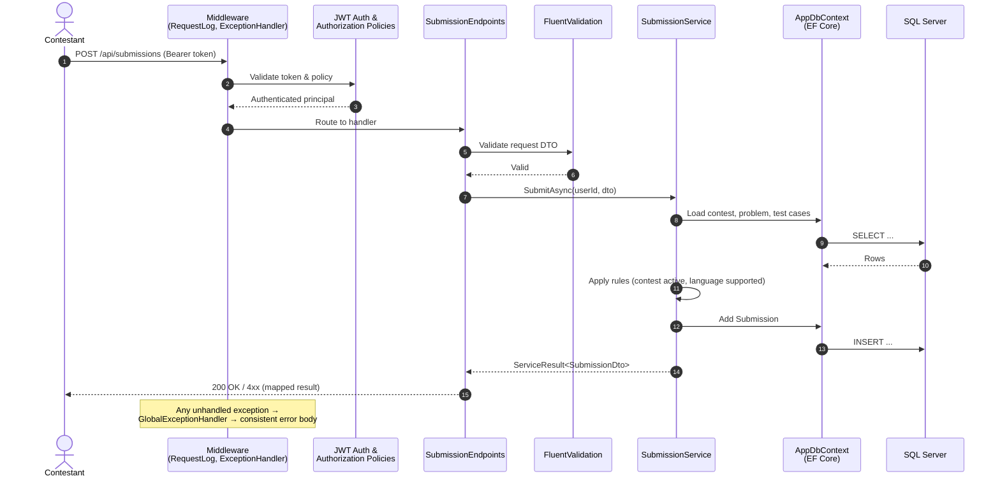
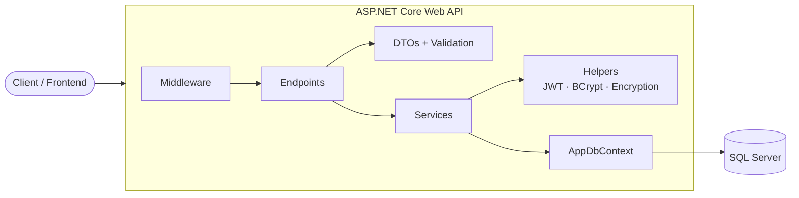
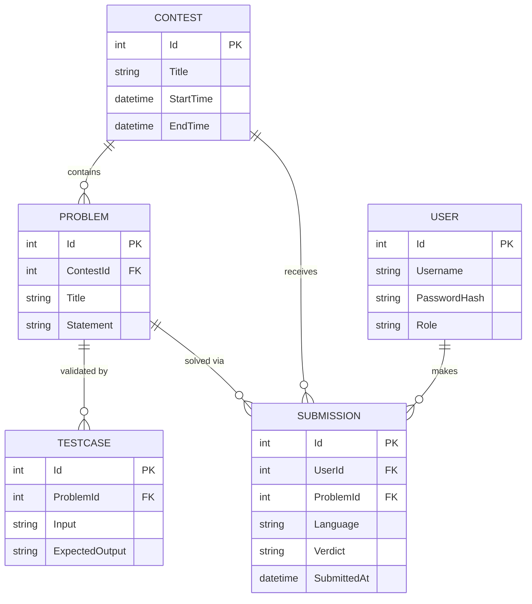

<div align="center">

# 🏆 Programming Contest Platform

**A secure, extensible REST API for hosting competitive programming contests.**


</div>

---

## 📖 Overview

**Programming Contest Platform** is a backend service for running online programming competitions. It manages the full contest lifecycle: user registration and authentication, contest and problem authoring, code submissions against test cases, and live standings.

**The problem it solves:** running a contest usually means stitching together spreadsheets, ad-hoc judges and manual scoring. This API gives organizers one consistent, secured system where:

- Admins create contests, problems and hidden test cases.
- Contestants register, join contests and submit solutions in supported languages.
- Standings are computed server-side and exposed through a dedicated endpoint.
- Sensitive data is protected with hashed passwords, signed tokens and an encryption service.

---

## 🏗️ Architecture & Design Patterns

The solution is a **layered, feature-oriented ASP.NET Core application** built on Minimal APIs. Responsibilities are separated by folder and enforced through interfaces and dependency injection.

| Layer | Folder(s) | Responsibility |
|---|---|---|
| **Presentation** | `Endpoints/`, `Middleware/` | Maps HTTP routes to service calls and handles cross-cutting concerns (exception handling, request logging). |
| **Application / Business** | `Services/` (`I*Service` + implementations) | Business rules: contest lifecycle, submissions, standings, auth, admin operations, encryption and session management. |
| **Contracts** | `DTOs/` | Request/response shapes, so persistence entities are never exposed directly. |
| **Domain Models** | `Models/` | Entities (`User`, `Contest`, `Problem`, `TestCase`, `Submission`) and `ServiceResult`. |
| **Data Access** | `Data/`, `Migrations/` | `AppDbContext`, per-entity Fluent API configurations, EF Core migrations. |
| **Shared Helpers** | `Helper/` | JWT generation, password hashing, authorization policy constants and extensions, supported languages. |

### Design patterns in use

| Pattern | Where |
|---|---|
| **Dependency Injection** | Every service sits behind an interface (`IAuthService`, `IContestService`, …) registered in `Program.cs`. |
| **DTO pattern** | `AuthDto`, `ContestDtos`, `ProblemDtos`, `SubmissionDto`, `UserDtos`, `ContestantStandingDto`. |
| **Result pattern** | `ServiceResult` returns success/failure from services without exceptions for expected failures. |
| **Entity Type Configuration** | `Data/Configurations/*Config.cs` keep mapping out of entities and out of `OnModelCreating`. |
| **Global exception handling** | `GlobalExceptionHandler` turns unhandled exceptions into consistent error responses. |
| **Policy-based authorization** | `AuthorizationConstants` and `AuthorizationServiceExtensions` centralize roles and policies. |
| **Minimal API endpoint grouping** | One static endpoint class per feature area (`Endpoints/*.cs`). |

> EF Core's `DbContext` already acts as a unit of work and repository, so no separate Repository or CQRS layer is used.

---

## ✨ Key Features

- 🔐 **Authentication**: register and log in, with JWT bearer tokens and server-side session management.
- 👥 **Role management**: admin and contestant roles enforced via authorization policies, plus a dedicated admin endpoint group.
- 🏁 **Contest management**: create and configure contests, attach problems and control participation.
- 🧩 **Problem and test-case authoring**: problems with multiple test cases.
- 📤 **Submissions**: submit solutions in supported languages and track their results.
- 📊 **Leaderboard**: computed contestant standings per contest.
- 🛡️ **Security**: BCrypt password hashing, configurable encryption service, request logging, centralized error handling.
- 📚 **Interactive API docs**: OpenAPI document plus Scalar UI.
- 🐳 **Container-ready**: `Dockerfile` and `.dockerignore` included.
- 🧪 **Tested**: xUnit test project with Moq and EF Core InMemory, plus Coverlet coverage.

---

## 🧰 Tech Stack

| Category | Technology |
|---|---|
| **Framework** | .NET 10, ASP.NET Core Minimal APIs |
| **Language** | C# |
| **Database** | Microsoft SQL Server |
| **ORM** | Entity Framework Core (SqlServer provider, Migrations) |
| **Authentication** | `Microsoft.AspNetCore.Authentication.JwtBearer`, `System.IdentityModel.Tokens.Jwt` |
| **Password Hashing** | BCrypt.Net-Next |
| **Validation** | FluentValidation |
| **API Docs** | Microsoft.AspNetCore.OpenApi, Scalar.AspNetCore |
| **Testing** | xUnit, Moq, EF Core InMemory, Coverlet (Cobertura reports) |
| **DevOps** | Docker, GitHub Actions |

---

## 🔄 Architecture Diagram

### Request flow: submitting a solution



### Component view



---

## 🗄️ Database Schema



Contest standings are a computed read model derived from submissions, not a stored table.

---

## 🔌 API Documentation

Full interactive documentation is available at `/scalar/v1` when the app is running.

### Authentication
| Method | Route | Description | Auth |
|---|---|---|---|
| `POST` | `/api/auth/register` | Register a new user | ❌ |
| `POST` | `/api/auth/login` | Authenticate and receive a JWT | ❌ |
| `POST` | `/api/auth/logout` | End the current session | ✅ |

### Users
| Method | Route | Description | Auth |
|---|---|---|---|
| `GET` | `/api/users/me` | Get current user profile | ✅ |
| `PUT` | `/api/users/me` | Update current user profile | ✅ |

### Contests
| Method | Route | Description | Auth |
|---|---|---|---|
| `GET` | `/api/contests` | List contests | ✅ |
| `GET` | `/api/contests/{id}` | Contest details | ✅ |
| `POST` | `/api/contests` | Create a contest | 🔑 Admin |
| `PUT` | `/api/contests/{id}` | Update a contest | 🔑 Admin |
| `GET` | `/api/contests/{id}/standings` | Leaderboard for a contest | ✅ |

### Problems
| Method | Route | Description | Auth |
|---|---|---|---|
| `GET` | `/api/problems/{id}` | Problem details | ✅ |
| `POST` | `/api/problems` | Create a problem with test cases | 🔑 Admin |
| `PUT` | `/api/problems/{id}` | Update a problem | 🔑 Admin |
| `DELETE` | `/api/problems/{id}` | Delete a problem | 🔑 Admin |

### Submissions
| Method | Route | Description | Auth |
|---|---|---|---|
| `POST` | `/api/submissions` | Submit a solution | ✅ |
| `GET` | `/api/submissions/{id}` | Get a submission and its result | ✅ |
| `GET` | `/api/submissions/me` | List the current user's submissions | ✅ |

### Administration
| Method | Route | Description | Auth |
|---|---|---|---|
| `GET` | `/api/admin/users` | List all users | 🔑 Admin |
| `PUT` | `/api/admin/users/{id}/role` | Change a user's role | 🔑 Admin |

Legend: ❌ public · ✅ authenticated · 🔑 role-restricted

---

## 🚀 Getting Started

### Prerequisites

- [.NET 10 SDK](https://dotnet.microsoft.com/download)
- SQL Server 2019+ (local, Docker or Azure SQL)
- [`dotnet-ef`](https://learn.microsoft.com/ef/core/cli/dotnet) tool
- Git (optional: Docker)

```bash
dotnet tool install --global dotnet-ef
```

Run SQL Server quickly with Docker:

```bash
docker run -e "ACCEPT_EULA=Y" -e "MSSQL_SA_PASSWORD=Your_strong_Passw0rd!" \
  -p 1433:1433 --name contest-sql -d mcr.microsoft.com/mssql/server:2022-latest
```

### Installation

```bash
# 1. Clone
git clone https://github.com/AnsElgyarDev/Programming-Contest-Platform.git
cd Programming-Contest-Platform

# 2. Restore dependencies
dotnet restore

# 3. Configure secrets (see Configuration below)
cd src/Programming-Contest-Platform
dotnet user-secrets init
dotnet user-secrets set "ConnectionStrings:DefaultConnection" "Server=localhost,1433;Database=ContestPlatform;User Id=sa;Password=Your_strong_Passw0rd!;TrustServerCertificate=True"
dotnet user-secrets set "Jwt:Key" "<at-least-32-characters-random-secret>"

# 4. Apply migrations
dotnet ef database update

# 5. Run
dotnet run
```

Open the interactive docs at `https://localhost:<port>/scalar/v1`.

### Configuration

```json
{
  "ConnectionStrings": {
    "DefaultConnection": "Server=localhost,1433;Database=ContestPlatform;User Id=sa;Password=<password>;TrustServerCertificate=True"
  },
  "Jwt": {
    "Key": "<min-32-char-secret>",
    "Issuer": "ProgrammingContestPlatform",
    "Audience": "ProgrammingContestPlatformClients",
    "ExpiryMinutes": 60
  },
  "Encryption": {
    "Key": "<base64-key>"
  }
}
```

Environment-variable form (double underscore replaces `:`):

```bash
export ConnectionStrings__DefaultConnection="Server=...;Database=ContestPlatform;..."
export Jwt__Key="<secret>"
export Encryption__Key="<base64-key>"
```

> ⚠️ Never commit real secrets. Use User Secrets locally and a secret manager in production.

### Running tests

```bash
dotnet test --collect:"XPlat Code Coverage"
```

### Docker

```bash
docker build -t programming-contest-platform .
docker run -p 8080:8080 \
  -e ConnectionStrings__DefaultConnection="..." \
  -e Jwt__Key="..." \
  programming-contest-platform
```

---

## 🔒 Security & Best Practices

| Area | Implementation |
|---|---|
| **Password storage** | Passwords are hashed with **BCrypt** (adaptive work factor, per-password salt). Plaintext is never stored or logged. |
| **Token authentication** | Stateless **JWT bearer** tokens validated by ASP.NET Core's JWT middleware (issuer, audience, lifetime, signature). |
| **Session handling** | A session manager tracks session state alongside tokens. |
| **Authorization** | Role and policy-based checks defined centrally. Admin routes are never reachable with a contestant token. |
| **Data encryption** | A dedicated encryption service protects sensitive values. See [`Docs/EncryptionServices.md`](src/Programming-Contest-Platform/Docs/EncryptionServices.md). |
| **Input validation** | **FluentValidation** on request DTOs, so invalid payloads are rejected before reaching business logic. |
| **DTO boundaries** | Entities are never serialized directly, which prevents over-posting and leaking internal fields such as hashes. |
| **Error handling** | A global exception handler returns consistent responses without stack traces or internals. |
| **Observability** | Request logging middleware records every incoming request. |
| **SQL injection** | All data access goes through EF Core's parameterized queries. |

### 🗺️ Roadmap

- [ ] Rate limiting (`Microsoft.AspNetCore.RateLimiting`) on `/auth/*` and `/submissions`
- [ ] Sandboxed code execution for judging, with CPU, memory and time limits
- [ ] Refresh tokens and token revocation
- [ ] HTTPS-only enforcement and HSTS in production
- [ ] Integration tests for endpoints

---

## 📁 Project Structure

```text
Programming-Contest-Platform/
├── src/Programming-Contest-Platform/
│   ├── Data/            # AppDbContext + entity configurations
│   ├── DTOs/            # Request/response contracts
│   ├── Endpoints/       # Minimal API route groups
│   ├── Helper/          # JWT, hashing, authorization helpers
│   ├── Middleware/      # Logging + global exception handler
│   ├── Migrations/      # EF Core migrations
│   ├── Models/          # Domain entities
│   ├── Services/        # Business logic (+ interfaces)
│   ├── Docs/            # Additional documentation
│   └── Program.cs       # Composition root
├── tests/Programming-Contest-Platform.Tests/
├── Dockerfile
└── Programming-Contest-Platform.slnx
```

---

## 🤝 Contributing

1. Fork the repo and create a branch: `git checkout -b feature/my-feature`
2. Commit using clear messages
3. Run `dotnet test` before opening a PR
4. Open a Pull Request describing the change

---

## 📄 License

Distributed under the **MIT License**. See `LICENSE` for details.
